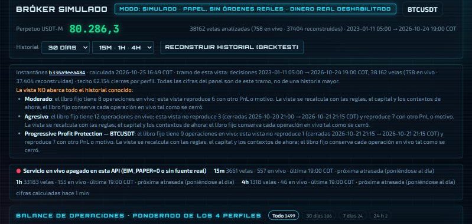

# T118 — Cifras auditables del bróker simulado (instantánea y motivos reales)

Fecha: 2026-10-25 · Alcance: bróker simulado (`v2/eim/paper`), su API y la franja superior del
panel. Todo SIMULADO; no cambia ninguna regla de entrada ni de salida, ningún tamaño ni ningún
peso (medido abajo). Rutas relativas a `v2/`.

## 1. Qué se cambió

| # | Entregable | Qué quedó | Dónde |
|---|---|---|---|
| 1 | **Instantánea de la vista** | Cada cálculo de la vista guarda, solo adición, la foto de lo que muestra el panel: cuenta y cifras de cada perfil, recuento con origen, alcance, conciliación con el libro fijo, rechazos por código, versiones (huella de cada perfil, mecánica, política y commit del código con «+cambios» si difiere), estado del almacén (contextos por marco, velas, funding) y sello de tiempo. Identificador = SHA-256 del JSON canónico (12 hex), visible y enlazado en la franja del panel. `GET /v2/paper/snapshot/<id>` devuelve exactamente esas cifras y recalcula la huella (`intact`); `GET /v2/paper/snapshots` las lista. Guardada comprimida (≈ 2,7 KB por foto). | `paper/snapshot.py`, `paper/desk_audit.py`, `api/paper.py`, tabla `paper_view_snapshot` |
| 2 | **El techo deja de ser silencioso** | `scope` en `/v2/paper`: tramo de decisiones y de cierres, techo (`ceiling` = ideas que la sombra no rechazó, el máximo de cierres de cualquier perfil con este almacén; no basta con las que la sombra ya cerró porque la escalera re-simula su propia salida) y huecos con su porqué — operaciones del libro fijo que la vista ya no reproduce o reproduce con otro PnL o motivo, e instantáneas anteriores que contaban más operaciones de un perfil (con qué cambió: almacén, parámetros o código). La franja dice «Todas las cifras del panel son de este tramo» y, si hay huecos, «La vista NO abarca todo el historial conocido» con cada uno. El Historial pedía 2 000 operaciones e ignoraba el total: su resumen (operaciones, acierto, PnL, PF) era parcial y parecía total; ahora dice «Lista parcial: las N más recientes de T» y la pestaña muestra `N/T`. | `paper/view_scope.py`, `web/src/paper_audit.ts`, `paper_tables.ts`, `paper_view.ts` |
| 3 | **Motivo de rechazo correcto** | Cada veto tiene un código estable (`vetoes.Veto.code`) que viaja en el evento `rechazada` y se cuenta por perfil (`counts.rejections`). Capital agotado o bajo el suelo = `cuenta_agotada` (y `capital_insuficiente`, defensivo), distinto de `tope_direccion` y `freno_drawdown`; la cantidad bajo el mínimo negociable (`cantidad_minima`, con el riesgo y el capital que la causaron) se separa de la geometría inválida (`geometria`), que antes compartían texto. | `paper/vetoes.py`, `paper/policy.py`, `paper/book.py`, `paper/summary.py` |
| 4 | **Una sola base de capital** | `account.capital(st)` es la única lectura de la cuenta: el motor dimensiona con ella (`policy.decide`, y se la pasa a los vetos), el panel la muestra (`summary.profile_summary`) y el libro fijo la guarda (`capital_before`/`capital_after` en cada cierre; columnas nuevas, NULL en filas anteriores). `ledger.reconcile` compara libro fijo y vista por perfil (`counts.ledger`). | `paper/account.py`, `paper/ledger.py`, `paper/book.py` |
| 5 | **Tests** | `tests/paper/test_auditable.py` (5) y `tests/paper/test_capital_base.py` (6), detalle en §5. | |
| 6 | **Nota de cierre** | Esta nota, con captura e identificador (§2). | `reports/t118/` |

Además: `paper_view.ts` pasaba de 300 líneas (303); su plantilla salió a `paper_template.ts` (268).
En la tarjeta de cuenta, el PnL flotante de la instantánea y el que se pinta en vivo con el precio
del flujo van en filas separadas («no entra en la instantánea ni en el capital de arriba»).

## 2. Ejemplo de auditoría

- Captura: `v2/reports/t118/panel_instantanea_b336a9eea484.png`. Foto guardada, tal como la devuelve
  `GET /v2/paper/snapshot/b336a9eea484`: `v2/reports/t118/snapshot_b336a9eea484.json` (`intact: true`).
- Cómo se obtuvo: la API en vivo corre el código de `main` (sin instantáneas hasta desplegar), así
  que se levantó una API **aislada** del worktree en el puerto 8118 sobre una copia: `paper.duckdb`
  de la copia de seguridad `eim_20261025-000020` (2026-10-25 00:00 UTC) y velas/funding de BTCUSDT
  y ETHUSDT copiados el 2026-10-25 ≈ 16:00 COT. La instantánea vive en esa copia, no en el almacén
  vivo; tras el despliegue el panel real mostrará las suyas.
- Lo que dice: tramo de decisiones 2023-01-11 05:00 → 2026-10-24 19:00 COT, 38 162 velas (758 en
  vivo · 37 404 reconstruidas), techo 62 154 cierres por perfil; Conservador 11 operaciones y
  9 958,41 USDT, Moderado 542 y 7 869,01, Agresivo 482 y 4 265,05, PPP 464 y 8 176,74. Y que
  **la vista NO abarca todo el historial conocido**: el libro fijo tiene operaciones en vivo que la
  vista ya no reproduce o reproduce con otro PnL (§3).
- Reproducible con operaciones nuevas en el almacén (la aceptación), en la misma API aislada:
  se reconstruyó un día de 1 h (`POST /v2/paper/backtest?days=1&tf=1h`): +21 contextos, +158
  ideas, +31 operaciones de la sombra (techo 62 154 → 62 185) y +29 rechazos por
  perfil (todas las estrategias que podían entrar estaban en pausa, así que los perfiles no
  sumaron cierres). La vista nueva es la instantánea `9d0c326782b3`
  (`v2/reports/t118/snapshot_9d0c326782b3.json`); pedir `b336a9eea484` después, dos veces,
  devolvió byte a byte lo mismo que antes del cambio (38 162 contextos, techo 62 154, los
  rechazos de entonces), con `intact: true`. Código de ambas: `4f1d5bff82c4+cambios` (el
  worktree antes del commit; la marca dice justo eso).

## 3. Medido en datos reales

**Ninguna cifra ni ningún peso cambia.** Misma copia (almacén de 2026-10-25 00:00 UTC), vista
completa de BTCUSDT y ETHUSDT con el código de `main` (4f1d5bf) y con el de T118: en los 4
perfiles × 2 símbolos son idénticos el número de operaciones, el capital realizado y el equity,
el PnL de cada operación, los pesos aprendidos (`weights`), los criterios del mínimo de abiertas
(`min_open.criteria`), `floor_r` y el texto de cada rechazo (BTCUSDT: 55 918 + 55 085 + 58 613 +
53 323 rechazos; ETHUSDT: 301 + 222 + 270).

**Motivo de rechazo.** El defecto de T106 (con capital ≤ 0 el rechazo salía como «tope de riesgo
abierto por dirección») ya lo había cerrado T107 (cuenta agotada como veto duro, primero de la
lista, y «capital insuficiente» si el riesgo deseado no es positivo). T118 lo fija con código y
test con los topes encendidos. En el almacén de hoy **ningún perfil está agotado**, así que no hay
ningún rechazo por capital: los 116 `tope_direccion` del Agresivo en BTCUSDT (capital 4 265 USDT,
−57 %) son el tope de verdad (riesgo abierto ≥ 3 % del capital en ese sentido), y los 97
`freno_drawdown`, el freno. Por códigos, BTCUSDT: Conservador `observacion` 55 918; Moderado
`pausa_estrategia` 46 206, `costo` 8 181, `contra_tendencia` 400, `rr` 270, `cupo` 15,
`pausa_contexto` 7, `freno_drawdown` 6; Agresivo `pausa_estrategia` 53 536, `costo` 4 461,
`contra_tendencia` 398, `tope_direccion` 116, `freno_drawdown` 97, `rr` 5.

**Aprendizaje por filtro saltado.** El diagnóstico de la fase 20 temía que un motivo equivocado lo
contaminara. Comprobado que no: ningún aprendizaje lee el motivo de un rechazo — `floor_r` solo
recibe el R de operaciones que SÍ entraron por el mínimo y se cerraron, y los pesos salen de los
cierres (sombra o propios). Por eso los pesos medidos arriba son idénticos; un test lo fija
(`test_el_aprendizaje_por_filtro_saltado_solo_ve_operaciones_cerradas`).

**Libro fijo frente a la vista** (`counts.ledger`, BTCUSDT): Moderado 8 filas, 6 con otro PnL o
motivo; Agresivo 12 filas, 3 que la vista ya no reproduce (cerradas 2026-10-20 21:00 → 10-21 21:15
COT) y 7 con otro PnL; PPP 9 filas, 1 fuera y 7 con otro PnL. Son operaciones registradas antes
de T109 (salidas por TP/tiempo) y dimensionadas con otro capital: el libro conserva lo que pasó y
la vista recalcula con las reglas de hoy. Antes esto no se veía en ningún sitio; ahora es un hueco
del alcance. ETHUSDT: sin filas de perfil en el libro y sin operaciones en vivo en la vista →
alcance completo.

**Las 19 132 operaciones del Agresivo.** No se pueden reconstruir: no había instantánea. Hoy el
techo de BTCUSDT es 62 154 (el almacén creció con la historia de T49/T111; con la cuenta de T106,
solo ideas ya cerradas por la sombra, serían 47 395) y el Agresivo tiene 482. A partir de T118 cualquier cifra que se vea en el panel lleva su identificador.

**Costo.** Sin sobrecoste medible. Vista de BTCUSDT sobre la misma copia, alternando código, tres
veces cada uno (con la API en vivo y los recolectores corriendo en el equipo, así que hay ruido):
el bucle de decisiones (`run_profile`, los 4 perfiles) tarda 19,7 / 19,3 / 18,9 s con T118 y
22,5 / 19,7 / 18,5 s con `main`; la auditoría (conciliación, alcance e instantánea) suma
0,2–0,3 s a una vista de ≈ 52–57 s. `Capital` se crea una vez por decisión (≈ 0,4 µs) y la
política se la pasa a los vetos.

**Revisión** (`code-review`, high): seis hallazgos. Corregidos: el techo contaba solo las ideas
ya cerradas por la sombra (falso para la escalera); un fallo al calcular el alcance impedía guardar
la foto (ahora se guarda igual con `scope.error`); una foto ilegible daba error 500 en vez de
`intact: false`. Anotados sin cambio: el hueco «una instantánea contaba más» no caduca, la lectura
del commit repite la de `data/backup.py` y la conciliación relee el libro fijo entero en cada
cálculo (BACKLOG T118 (8)).

## 4. Lo que NO se hizo (y a quién le toca)

- **Despliegue**: la API en vivo sigue con el código anterior hasta fusionar y reiniciarla (pedir
  permiso). Mientras, la franja dice «Sin instantánea: la API aún no la publica».
- Las instantáneas **no viajan** con la experiencia compartida (T61/T117): un colaborador no puede
  abrir el identificador de otro; se pide en la máquina que lo calculó (BACKLOG T118 (2)).
- **Retención**: sin poda; ≈ 16 MB al mes con los dos símbolos (BACKLOG T118 (3)).
- No se cambió ninguna regla de entrada o salida, ni la interfaz más allá de la franja de alcance,
  el aviso del Historial y la fila del flotante en vivo.

## 5. Pruebas

- `tests/paper/test_capital_base.py` (6): serie conocida (+2 %, −1 %, +1,5 % con riesgo 1 % y
  peso 1) → el motor dimensiona con 10 000 / 10 200 / 10 098, el panel y `account.capital` dicen
  10 249,47 y el libro fijo guarda exactamente esos `capital_before`/`capital_after` con el mismo
  número de operaciones; la conciliación delata una vista recalculada con otro capital o sin una
  operación; migración de un libro fijo anterior sin tocar sus filas; rechazo por capital con topes
  encendidos (nunca `tope_direccion` ni texto «tope»); tope y freno conservan su código;
  aprendizaje por filtro saltado solo con operaciones cerradas.
- `tests/paper/test_auditable.py` (5): la instantánea pedida devuelve la foto de entonces y no la
  nueva tras añadir 100 contextos (dos consultas idénticas, `intact`), una fila alterada (o
  ilegible) se delata con `intact: false` y un identificador desconocido da 404 sin inventar nada, `/trades` declara el tramo que devuelve,
  una operación del libro fijo fuera de la vista sale como hueco con su ventana, y una instantánea
  anterior que contaba más sale con su porqué.
- Interfaz: `npx tsc --noEmit` limpio; verificada en el navegador contra la API aislada (§2): las
  cifras de la franja y de las tarjetas son las de la foto guardada.
