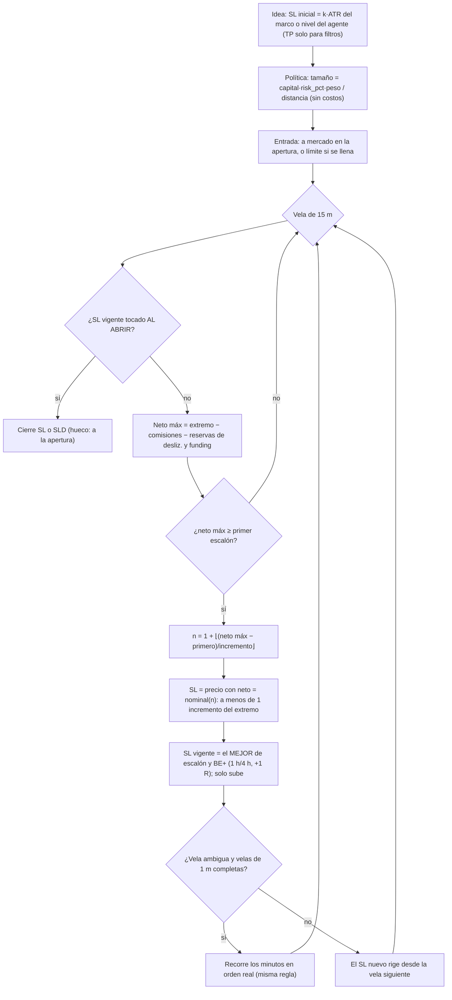
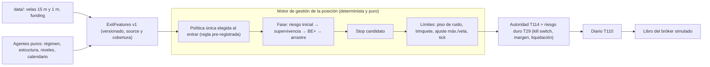

# T129 — Stop dinámico: auditoría, investigación y propuesta (fase 1, solo lectura)

**Modo: SIMULADO.** Encargo del usuario del 2026-11-03. En esta fase **no se cambió ni una línea de código**: lectura de `v2/eim/paper/`, del libro del bróker simulado (API local, solo GET) y de los informes previos (T105–T111). Lo único que se escribió en el almacén fue la reconciliación manual de la operación inconsistente del 31-oct, que el usuario aprobó antes de abrir esta fase (§1.5, H8).

- **Datos del libro:** 307 operaciones cerradas de los cuatro perfiles (BTCUSDT), con cierres entre 2026-10-17 10:05 y 2026-11-03 04:06 UTC. 184 son en vivo y 123 reconstruidas por el backtest de la vista. Se consultó el 2026-11-03 a las 05:2x UTC.
- **Evidencia larga:** el A/B de T111 (`v2/reports/ppp_profiles_ab.md`). Es emparejado y fuera de muestra: 2023-01-11 → 2026-08-15, 1 h y 4 h, con velas de 1 min reales.
- **Atención al leer las cifras:** las 307 operaciones **no son independientes**. Una misma idea la toman varios perfiles, y el periodo es corto (17 días, mayormente lateral). Sirven para *describir el mecanismo*; la evidencia estadística es la de T111.
- **Scripts de lectura:** fuera del repo, en el scratchpad de la sesión (`fetch_trades.py`, `analyze.py`, `extra.py`, `trail_vs_noise.py`, `losers_mfe.py`, `coverage.py`). T131 los convierte en código probado.

## Resumen ejecutivo

1. **Lo que se percibió como un avance es justo lo que hace perder dinero.** La escalera sube el acierto al 75,6 %, pero las ganadoras cobran de media **+0,108 R** y las perdedoras pierden **−0,964 R** (PF 0,35). Con ese reparto se necesita un **90 %** de acierto solo para empatar. En el Agresivo, sus 10 peores operaciones (−1 127 USDT) se llevan por delante sus 113 ganadoras (+874 USDT).
2. **La causa es de diseño, no un fallo.** El stop de cada escalón se coloca en el precio cuyo neto *es* ese escalón, así que queda a **menos de un incremento** del extremo alcanzado. El incremento es 0,0375–0,05 R, que en precio son **27–61 USD de BTC**. La vela de 1 min mediana mide **29 USD** y la de 15 min **147 USD**. El stop dinámico vive dentro del ruido de un minuto: el 69 % de los cierres dinámicos salen en el primer escalón, con una mediana de 44 min.
3. **La escalera no convierte ganadoras en pérdidas grandes.** Las 62 pérdidas por stop inicial **nunca** llegaron al primer escalón. El problema es el contrario: corta las ganadoras. En las 20 operaciones en que la salida de la sombra (TP 2,5 ATR / BE+ / tiempo) llegó al TP, la escalera cobró **+0,089 R** y la sombra **+1,551 R**.
4. **Los costos se comen la mayor parte de lo ganado.** El costo medio es 0,120 R por operación: **59 % del beneficio bruto** de los cierres dinámicos (1 855 de 3 144 USDT). Cada stop inicial cuesta −1,143 R y no −1 R, porque el riesgo por operación no incluye los costos.
5. **Esto ya estaba medido.** T111 (3,6 años fuera de muestra) halló que la escalera **empeora a los tres perfiles**: PF 0,39–0,45 frente a 0,75–0,87 de la salida anterior. Las ganadoras bajan de +0,85 R a +0,11 R. El usuario la adoptó igualmente el 2026-10-23 (◆ de T111). Lo que hoy se ve en el bróker es la confirmación en vivo.
6. **El techo real son las entradas.** Ninguna salida convierte en rentable una entrada sin ventaja. Antes de costos, la esperanza es ≈ 0: −0,034 R en el libro vivo, y −0,01 a +0,03 R para la salida A en T111. La puerta de edge (T27) **no pasa** y ninguna estrategia está validada (T49). Una salida mejor puede bajar el drawdown y quitar la asimetría de las pérdidas, pero **un PF > 1 sostenido exige ventaja en la entrada**.
7. **La literatura apunta en la misma dirección.**
   - Un stop solo añade valor si hay momento o regímenes persistentes (Kaminski y Lo, 2014).
   - Con costos, un stop ajustado rinde menos que no tenerlo (Lo y Remorov, 2017).
   - En paseo aleatorio, el stop dinámico no mejora la esperanza (Glynn e Iglehart, 1995).
   - T111 lo confirma con datos propios: la escalera gana en días laterales y pierde lo que A ganaba en días de tendencia.
8. **Propuesta.** Un único **motor de gestión de la posición**, determinista y puro:
   - Stop inicial con distancia mínima por volatilidad y tamaño que incluya costos.
   - Sin protección hasta salir del ruido. Después, BE+ y arrastre por volatilidad o estructura, con un piso de distancia.
   - Una sola política activa por posición, nunca «el mejor de varios», que siempre aprieta.
   - Los agentes solo aportan rasgos versionados.
   - Se valida en un banco emparejado, pre-registrado, con walk-forward y un control de entradas al azar. Plan en §5: T130–T136.

## 1. Entregable 1 — Auditoría del sistema actual

### 1.1 Qué se leyó

`v2/eim/paper/ladder.py` (295 l.), `ladder_math.py`, `ladder_params.py`, `ladder_floor.py`, `params.py` (`ExecParams`, `ProfileParams`, `LADDER_BY_PROFILE`, `PROFILES`), `engine.py` (sombra y BE+), `ideas.py` (`atr_draft`), `strategies*.py` (origen del SL), `protection_sync.py` / `protection_desk.py` (diario T110), `caps.py` / `policy.py` (tamaño y topes). Además, el estado de T105–T111 en `STATUS.md` y el informe `v2/reports/ppp_profiles_ab.md`.

### 1.2 Cómo funciona en realidad (las 10 preguntas del encargo)

1. **SL inicial.** Lo fija la idea, no el gestor:
   - `atr_draft` (`ideas.py:131`) lo pone a `k·ATR` del marco de decisión. k es 1,5 en agentes, literatura y por defecto; 1,2 en consenso; 2,0 en base; 2,2 en `ppp_tendencia` (`strategies_ppp.py:33`).
   - Otras familias usan un nivel propio: el SL del plan (`plan_tp1/2`), el de las sugerencias, la invalidación de escenarios, Supertrend o bandas.
   - El tamaño es `capital·risk_pct·peso / |entrada − SL|` (`policy.py:127`, `ladder_book.py:41`). El riesgo es 0,5 / 1 / 2 % y 0,5 % en `ppp_btcusdt`. **No incluye los costos.**
   - Distancia mediana en precio (libro vivo): 717–1 220 USD en el Agresivo, 932–1 220 en el Moderado y 1 010–1 248 en `ppp_btcusdt`.
2. **Activación.** Cuando el **beneficio NETO máximo estimado** llega al primer escalón (`ladder_math.level_of`). Es 0,100 R en Conservador y Moderado, 0,075 R en el Agresivo (`params.py:144`) y +10 USDT fijos en el control.
   - El neto descuenta comisión de entrada y salida, deslizamiento de entrada, una reserva de deslizamiento de salida (el mayor de las últimas 4 velas: 1 pb + 0,10 × rango) y una liquidación de funding.
   - Por eso la activación exige un avance **bruto** de primer escalón + costos ≈ 0,2–0,3 R (54–250 USD + 84–123 USD de costos).
   - En 1 h y 4 h también existe el BE+ (+1 R → entrada + costos + 0,1 R), que convive con la escalera.
3. **Desplazamiento.** El escalón es `n = 1 + ⌊(neto máx − primero)/incremento⌋`. El SL es el precio cuyo neto es `primero + (n−1)·incremento`, redondeado al tick en contra del operador (`protect_price`).
   - **Consecuencia:** la distancia entre el extremo alcanzado y el SL está siempre en [0, 1 incremento) de neto.
   - Eso son 27–46 USD en el Agresivo, 47–61 en el Moderado y 102–125 en el control. Es un arrastre fijo en dólares, no en volatilidad.
4. **Qué interviene.** Solo precio, costos y la cantidad. No intervienen la volatilidad (salvo el rango de vela en la reserva), la estructura, la liquidez, el tiempo ni ninguna señal de agente. Las señales contrarias «solo informan» (T109, `against`).
5. **Protección de una operación en ganancia.** Trinquete: el SL solo sube (`_up`) y la salvaguarda `_never_lower` impide que una ruta automática lo baje. Una vez activa, la protección nunca vuelve a la entrada.
6. **Retrocesos, volatilidad, movimientos bruscos.**
   - Cualquier retroceso mayor que un incremento (≈ 1 min de ruido) cierra la operación.
   - Con más volatilidad, la reserva de deslizamiento crece: hace falta más avance para activar, pero el arrastre sigue en un incremento.
   - Un hueco más allá del SL se ejecuta a la apertura (`_stop_exit`).
   - En el camino de 15 min, el avance de una vela solo sube el SL desde la siguiente. Si la vela es ambigua y hay velas de 1 min completas, se recorre en orden real.
7. **Temporalidades.** Mismos umbrales en R para 15 m, 1 h y 4 h. Como R escala con el ATR del marco, en precio el arrastre crece con el marco (Agresivo: 27 USD en 15 m, 29 en 1 h, 46 en 4 h). Pero el camino es siempre de 15 m (más 1 m en velas ambiguas), así que frente al ruido que realmente lo cierra el arrastre es igual de corto en todos los marcos.
8. **Relación SL–TP.** En modo escalera no hay TP (`LadderParams` prohíbe TP fijo y cierre por tiempo). El TP de la idea solo sirve para filtros de entrada (`min_rr` 1,1–1,5; `min_target_vs_first`). Se filtra por un R:B de 1,1–1,67 que la salida nunca persigue: la ganadora media cobra 0,11 R.
9. **Volatilidad, estructura, liquidez.** Solo a través del SL inicial (ATR o nivel del agente) y de la reserva de deslizamiento. Nada de estructura ni liquidez una vez abierta la posición.
10. **Cambios de tendencia, falsas rupturas.** No hay tratamiento. Una falsa ruptura que va a favor 0,2–0,3 R y vuelve deja la operación en +0,08 R (escalón 1). Una que va en contra la lleva al SL inicial. Una tendencia real queda cortada en el primer retroceso de un minuto.

### 1.3 Diagrama de la lógica actual



### 1.4 Lo que dice el libro real

| Perfil | Ops | Acierto | Ganadora media | Perdedora media | E[R] neto | PF | Neto USDT | Costo medio | E[R] bruto |
|---|--:|--:|--:|--:|--:|--:|--:|--:|--:|
| Agresivo | 147 | 76,9 % | +0,084 R | −0,784 R | −0,117 | 0,35 | −1 593 | 0,132 R | +0,016 |
| Moderado | 110 | 78,2 % | +0,102 R | −1,094 R | −0,159 | 0,29 | −575 | 0,106 R | −0,053 |
| Conservador | 11 | 45,5 % | +0,124 R | −1,188 R | −0,591 | 0,09 | −160 | 0,163 R | −0,428 |
| `ppp_btcusdt` (10/5 USDT fijos) | 39 | 71,8 % | +0,216 R | −1,119 R | −0,160 | 0,49 | −309 | 0,104 R | −0,056 |
| **Todos** | **307** | **75,6 %** | **+0,108 R** | **−0,964 R** | **−0,154** | **0,35** | **−2 637** | **0,120 R** | **−0,034** |

- **Por motivo de cierre.**
  - **SL inicial:** 62 operaciones, todas perdedoras, a −1,143 R de media (−1,000 R bruto + 0,143 R de costo). Suman −3 926 USDT.
  - **SLD (stop dinámico):** 245 operaciones, 245 por escalón y **0 por BE+**. Bruto +3 144 USDT, costos 1 855 USDT, neto +1 289 USDT.
  - El neto total (−2 637) es exactamente la suma de los dos.
- **Escalón al cierre del SLD:** escalón 1 en 169 (69 %), escalón 2 en 55, escalón 3 o más en 21. Cierres en ≤ 30 min: 91 de 245.
- **Captura del recorrido favorable:** con entradas a mercado, las ganadoras alcanzan un MFE medio de 0,333 R y realizan +0,103 R, es decir **31 %**. El control `ppp_btcusdt`, con escalones más anchos (≈ 0,2 / 0,1 R), captura 54 % y gana +0,216 R por ganadora. Lo mismo se ve en la sensibilidad de T111: a más ancho, más captura.
- **Duración mediana:** ganadoras 29–99 min, perdedoras 98–465 min. Se cortan las ganadoras y se deja correr a las perdedoras hasta su SL: es el patrón inverso al de la gestión clásica, y el mismo sesgo que el «efecto disposición» (Shefrin y Statman, 1985).
- **Concentración:** las 10 peores de cada perfil frente a todas sus ganadoras.
  - Agresivo: −1 127 frente a +874 USDT (113 ganadoras).
  - Moderado: −465 frente a +230 (86).
  - `ppp_btcusdt`: −555 frente a +296 (28).
- **Acierto necesario para empatar con la pérdida media de −0,964 R:**

  | Ganadora media | Acierto de equilibrio |
  |--:|--:|
  | +0,108 R (hoy) | 90,0 % |
  | +0,25 R | 79,4 % |
  | +0,5 R | 65,9 % |
  | +1 R | 49,1 % |
- **Frente a la sombra de la misma idea** (feed en vivo, 60 cierres dinámicos emparejados):
  - Cuando la sombra llegó al TP (20 casos): escalera +0,089 R, sombra +1,551 R.
  - Cuando la sombra perdió por SL (29 casos): escalera +0,066 R, sombra −1,102 R.
  - En este periodo, lateral (219 de 307 operaciones con régimen ex ante «range»), las dos cosas casi se compensan. En 3,6 años (T111) gana la sombra.
- **Arrastre frente al ruido:**

  | Vela BTCUSDT | Rango mediano | Rango p90 |
  |---|--:|--:|
  | 1 min | 28,9 USD | 77,8 USD |
  | 15 min | 146,9 USD | 335,0 USD |
  | 1 h | 310,9 USD | 711,6 USD |
  | 4 h | 721,0 USD | 1 411,6 USD |

  El incremento en precio es 26,9 / 29,3 / 45,7 USD en el Agresivo (15 m / 1 h / 4 h) y 46,6 / 46,7 / 61,0 en el Moderado.

### 1.5 Hallazgos: errores, redundancias, lógica muerta e incoherencias

| Id | Gravedad | Dónde | Hallazgo | Evidencia | Efecto |
|---|---|---|---|---|---|
| H1 | **Crítico (diseño)** | `ladder_math.py:57-66`, `ladder.py:112-122` | El SL del escalón se coloca a menos de un incremento del extremo; el arrastre no depende de la volatilidad | Incremento de 27–61 USD frente a 29 USD de rango mediano en 1 min; 69 % de los SLD salen en el escalón 1 | Ganadoras de +0,11 R; acierto de equilibrio del 90 % |
| H2 | **Alto** | `params.py:85,95-99`, `policy.py:127` | El riesgo por operación no incluye los costos, y `max_cost_r` admite hasta 0,12–0,20 R | Pérdida por SL de −1,143 R; los costos son el 59 % del bruto del SLD | Cada pérdida es un 14 % mayor de lo presupuestado y casi no queda margen para la ventaja |
| H3 | Medio | `ladder.py:159-169, 123-128`; `be_with_ladder` | El BE+ conviviendo con la escalera es **lógica muerta** en la práctica: se arma a +1 R, pero la escalera ya cerró mucho antes | 0 de 245 SLD por BE+ | Parámetros (`be_*` en modo escalera) sin efecto real que complican la lectura y el versionado |
| H4 | Medio | `params.py:89` (`min_rr`), `ladder_params.py:73` (`min_target_vs_first`) | Los filtros de entrada exigen un R:B (TP de la idea) que la salida nunca persigue | R:B nominal 1,1–1,67; ganadora media de 0,11 R | Se seleccionan entradas por un criterio ficticio |
| H5 | Medio (diseño) | `ladder.py:123-129` (◆3 de T106) | «El SL vigente es el MEJOR de los candidatos»: combinar métodos tomando el más protector siempre aprieta | Regla general: el máximo de varios stops es el más cercano | Si el sistema híbrido se diseña así, hereda H1 |
| H6 | Medio (medición) | `ladder.py:258-260`, `engine.py:246-250` | El MFE/MAE se mide desde la **vela del llenado completa**: en entradas límite cuenta extremos anteriores al llenado. Además, la sombra recorta el MFE/MAE al TP/SL y la escalera no, así que no son comparables | 3 entradas límite con MFE ≥ 0,2 R y neto máximo < 0 (p. ej. MFE 0,489 R con neto máx −51 USDT) | MFE posiblemente inflado en las 116 entradas límite (38 % del libro); causas «casi TP» y «SL rápido» (`engine.py:87-93`) mal etiquetadas a veces; cualquier análisis MAE/MFE queda sesgado |
| H7 | Medio | `ladder_floor.py:99-106` (`early`) | **Falso positivo de T110:** un escalón fijado al cierre de una vela de 15 m con la regla conservadora (velas de 1 m aún incompletas en ese instante) queda «inconsistente» cuando, con las 1 m ya completas, el recálculo lo cierra dentro de esa misma vela | Caso del 31-oct (corto del Agresivo, `agente_levels@1h`): las velas de 1 m y los trades HFT confirman el toque del SL a las 03:40:03 UTC; la «foto viva» de las 03:45 tenía el precio ya pasado su stop | Posición fantasma 3 días, con cupo de riesgo ocupado (16 cortos del Agresivo rechazados por el tope por dirección en ese tiempo, sin atribución comprobada). **Resuelto a mano el 2026-11-03** (`recalculo`): SLD a 77 164,5, +0,11 R |
| H8 | Bajo | `book.py:109`, `ladder_book` | La memoria propia de la escalera aprende de ganadoras recortadas y pérdidas completas: E[R] de la estrategia ≈ −acierto de SL | T111: el libro con escalera opera mucho menos por «estrategia en pausa» | Pausas por una salida mala, no por una entrada mala |
| H9 | Info | `ladder_params.py:96-98`, T109 | No hay forma de **reducir exposición** (cierre parcial) ni de salir por tiempo: TP fijo y tiempo están prohibidos por diseño (T105) | — | Cualquier «protección parcial» del encargo exige una decisión ◆ |
| H10 | Info | `ladder.py:217-250` | Se comprobó que **no hay lookahead** en el camino de 15 m: SL al abrir y avance desde la vela siguiente; 1 m solo en velas ambiguas | Prueba de T111 con orden sintético favorable: la escalera casi empata (−0,005 R/op en el Agresivo) | El resultado depende mucho del orden dentro de la vela: está operando el ruido |

Revisión de duplicados y código muerto: la mecánica de costos y huecos está compartida (`engine._slip`, `_stop_exit`, `_funding`, reexportados sin copia). No se encontró lógica duplicada fuera de H3 y H6. Los «prohibidos» de `LadderParams` (`fixed_take_profit`, `time_exit`, `real_money`) son configuración visible que nunca se puede activar. Es intencionado (T105), pero ocupa superficie.

### 1.6 Diagnóstico: por qué unas pocas pérdidas borran muchas ganancias

En orden de peso:

1. **Asimetría de pagos creada por la salida** (H1). Las perdedoras van hasta el SL inicial (−1,14 R con costos) y las ganadoras se cierran a +0,1 R. Es una opción vendida: muchas primas pequeñas y una pérdida grande de vez en cuando.
2. **Costos del mismo orden que la ganancia** (H2). 0,12 R por operación frente a ganadoras de 0,11 R. Una salida que sube la frecuencia y baja el tamaño de la ganancia empeora la relación costo/ganancia.
3. **Entradas sin ventaja.** La esperanza bruta ≈ 0 (T27, T49, T111). Ninguna salida lo arregla sola: el máximo que se puede pedir a la salida es no destruir la poca ventaja que haya y controlar la cola de pérdidas.
4. **Dinámica de precio de BTC en este horizonte.** En días de tendencia, A (TP 2,5 ATR) gana +0,19…+0,26 R/op y la escalera pierde. En días laterales, la escalera pierde menos (T111). El régimen ex ante que hoy asigna el agente no anticipa qué día viene: «range» abarca el 77 % de los casos y los dos pierden ahí.

## 2. Entregable 2 — Investigación técnica

### 2.1 Metodologías y lo que aplica aquí

| Línea | Qué establece (fuente) | Aplicación aquí |
|---|---|---|
| Stops y su valor | Un stop simple **reduce** la esperanza en paseo aleatorio; añade valor con momento o con regímenes de Markov (Kaminski y Lo, 2014). Con costos, los stops ajustados rinden menos que no tenerlos; los amplios son atractivos si los regímenes son persistentes (Lo y Remorov, 2017) | **Sí, como criterio rector.** Prohibir arrastres dentro del ruido; medir el momento o la reversión de BTC al horizonte de cada marco antes de elegir la salida |
| Paradas óptimas con stop dinámico | En paseo aleatorio o movimiento browniano geométrico, el trailing no mejora la esperanza (Glynn e Iglehart, 1995, según lecturas posteriores). Con reversión (Ornstein–Uhlenbeck) existe un trailing óptimo combinado con orden límite (Leung y Zhang, 2019/2021) | **Con condiciones.** Justifica que el arrastre ajustado funcione en lateral y falle en tendencia; el parámetro óptimo depende de la dinámica, no se fija a ojo |
| Stop por volatilidad (ATR, Chandelier) | Stop = extremo desde la entrada − k·ATR, con k ≈ 3 (Chandelier de LeBeau, difundido por Elder) | **Sí.** Es el candidato base (M2): trivial de implementar, sin dependencias, arrastre proporcional al ruido |
| MAE/MFE | Usar la distribución del MAE de las ganadoras para fijar el stop inicial y la del MFE para fijar objetivos y arrastres (Sweeney, 1997) | **Sí, tras corregir H6.** Es la forma de fijar «a partir de cuánto avance se protege» con datos, no a mano |
| Triple barrera y meta-etiquetado | Etiquetado con stop, objetivo y tiempo dinámicos por volatilidad; un segundo modelo decide si se toma y cuánto (López de Prado, 2018) | **Con condiciones.** La triple barrera es un buen *banco de etiquetas* (T131). El meta-etiquetado es trabajo de entradas (T49) y exige muestra grande |
| Volatilidad condicional y realizada | GARCH (Bollerslev, 1986); HAR-RV (Corsi, 2009) es el patrón de referencia para pronosticar la volatilidad de BTC con datos intradía, y a corto plazo cuesta superarlo con extensiones (estudios con BTC, p. ej. Bouri et al., 2021) | **Sí, HAR-RV con las velas de 1 m:** da la unidad de volatilidad del arrastre. GARCH solo si HAR no basta (añade dependencia) |
| Volatilidad objetivo (tamaño) | Gestionar por volatilidad sube el Sharpe en activos de riesgo y reduce la cola izquierda en todas las clases (Moreira y Muir, 2017; Harvey et al., 2018). Las CTA dimensionan cada mercado para el mismo riesgo (Hurst, Ooi y Pedersen, 2017). Para BTC no hay un estudio revisado que lo pruebe neto de costos | **Con condiciones.** Útil para el tamaño (T136), no para la salida; validarlo aquí, no suponerlo |
| Kelly fraccionado, f óptima | El tamaño óptimo crece con la ventaja; con esperanza ≤ 0 es **cero** (Kelly, 1956; Thorp; Vince) | **Sí, como freno.** Con E[R] ≤ 0 todo aumento de tamaño es contraproducente; impide «reforzar lo que gana» con muestras pequeñas |
| Control de drawdown | Exposición proporcional a la distancia al suelo de drawdown (Grossman y Zhou, 1993; CPPI) | **Sí, sencillo.** El freno actual (`dd_brake` 5 %, solo frena entradas) puede ser gradual (T136) |
| Riesgo de ruina, PF, esperanza | Esperanza en R y tamaño en R (Tharp); PF = ganado/perdido; acierto de equilibrio = pérdida/(ganancia + pérdida) | **Sí.** Métricas del banco; la ruina por *bootstrap* por bloques de días |
| Regímenes | Markov switching (Hamilton, 1989); HMM; detección de cambios bayesiana en línea (Adams y MacKay, 2007; **ya está** en `agents/regime/bocpd.py`); Efficiency Ratio de Kaufman, ADX, cociente de varianzas | **Solo si predice.** T133 mide si algún rasgo ex ante anticipa «tendencia o lateral» en las horas siguientes. Si no, no se adapta por régimen (T111 ya mostró que la etiqueta actual no separa) |
| Aprendizaje por refuerzo | Aprender la política de salida directamente (Moody y Saffell, 2001) y marcos como FinRL | **No en esta fase.** Muchos grados de libertad, poca muestra independiente (≈ 1 decisión/h en 1 h), sin ventaja de entrada y con alto riesgo de sobreajuste. Contraproducente hasta que exista una base que funcione |
| Clasificación de régimen con ML | Bosques o boosting sobre rasgos de volatilidad y tendencia | **Más tarde.** Solo si los rasgos simples de T133 muestran señal; misma disciplina de validación que T49 |

### 2.2 Repositorios públicos (metadatos verificados el 2026-11-03 con la API de GitHub)

Criterio: no se incorpora nada por popularidad. Las librerías permisivas pueden entrar como dependencia tras la revisión de T04. Los marcos con copyleft o licencias no estándar quedan como referencia de diseño u oráculo aislado.

| Repositorio | Licencia | ★ | Último push | Qué aporta aquí | Veredicto |
|---|---|--:|---|---|---|
| [QuantConnect/Lean](https://github.com/QuantConnect/Lean) | Apache-2.0 | 22 359 | 2026-11-02 | Marco con «modelo de gestión de riesgo» separado de alfa, cartera y ejecución (stop dinámico, drawdown y beneficio no realizado por valor) | **Referencia de arquitectura** (la separación del riesgo); C#, no se integra |
| [nautechsystems/nautilus_trader](https://github.com/nautechsystems/nautilus_trader) | LGPL-3.0 | 31 181 | 2026-11-03 | Órdenes stop dinámicas con desplazamiento en precio, puntos básicos o ticks; motor por eventos | Referencia; T25 ya optó por motor propio. Oráculo de contraste opcional |
| [freqtrade/freqtrade](https://github.com/freqtrade/freqtrade) | GPL-3.0 | 56 353 | 2026-11-03 | `custom_stoploss` (stop calculado por operación), arrastre que solo se activa tras un desplazamiento (`trailing_stop_positive_offset`) | **Referencia de diseño, no copiar** (GPL; T04/T56) |
| [jesse-ai/jesse](https://github.com/jesse-ai/jesse) | MIT | 8 760 | 2026-10-31 | API para mover SL/TP dentro de la posición | Referencia |
| [polakowo/vectorbt](https://github.com/polakowo/vectorbt) | Apache-2.0 + Commons Clause (no OSI) | 9 651 | 2026-10-28 | `from_signals` con `sl_stop`, `sl_trail`, `tp_stop`: barre rejillas de salidas muy rápido | Oráculo de contraste opcional en entorno aislado; **no** dependencia del proyecto |
| [kernc/backtesting.py](https://github.com/kernc/backtesting.py) | AGPL-3.0 | 9 180 | 2026-08-05 | Estrategia con stop dinámico por ATR | Descartar (AGPL) |
| [mementum/backtrader](https://github.com/mementum/backtrader) | GPL-3.0 | 23 644 | 2024-08-19 | Órdenes `StopTrail` | Descartar (inactivo, GPL) |
| [bashtage/arch](https://github.com/bashtage/arch) | NCSA (permisiva) | 1 664 | 2026-11-02 | GARCH/EGARCH y media HARX | Candidata a dependencia **solo si** HAR-RV propio no basta (◆ de dependencia) |
| [statsmodels/statsmodels](https://github.com/statsmodels/statsmodels) | BSD-3 | 11 734 | 2026-11-02 | Markov switching (Hamilton) | Candidata para T133 (◆ de dependencia); hoy el proyecto solo usa scipy |
| [hmmlearn/hmmlearn](https://github.com/hmmlearn/hmmlearn) | BSD-3 | 3 446 | 2024-10-31 | HMM | Mejor statsmodels o la BOCPD propia (mantenimiento limitado) |
| [TA-Lib/ta-lib-python](https://github.com/TA-Lib/ta-lib-python) | BSD-2 | 12 349 | 2026-11-01 | ATR, ADX, SAR | Innecesaria: el proyecto calcula sus indicadores; requiere binario C |
| twopirllc/pandas-ta | — | — | — | — | **El repositorio ya no existe** (404 el 2026-11-03): descartar |
| [ranaroussi/quantstats](https://github.com/ranaroussi/quantstats) · [stefan-jansen/empyrical-reloaded](https://github.com/stefan-jansen/empyrical-reloaded) | Apache-2.0 | 7 781 · 131 | 2026-11-02 | Definiciones de Sharpe, Sortino, recuperación | Referencia de fórmulas; el banco calcula las suyas con pruebas |
| [hudson-and-thames/mlfinlab](https://github.com/hudson-and-thames/mlfinlab) | Comercial (NOASSERTION) | 4 965 | 2023-10-02 | Triple barrera, meta-etiquetado | Descartar el código; se implementa el **método** del libro |
| [AI4Finance-Foundation/FinRL](https://github.com/AI4Finance-Foundation/FinRL) · [tensortrade](https://github.com/tensortrade-org/tensortrade) | MIT · Apache-2.0 | 16 969 · 7 255 | 2026-11-03 · 2026-02-19 | Aprendizaje por refuerzo | Descartar en esta fase (§2.1) |
| Repos pequeños de «trailing stop», «chandelier exit», «triple barrier», «market regime» | varias o ninguna | 0–1 500 | 2018–2026 | Bots de Binance o cuadernos | Descartar: sin pruebas, la mayoría inactivos o sin licencia; las fórmulas son triviales de escribir con pruebas propias |

**Conclusión:** reutilizar métodos, no código. Lo que hace falta (Chandelier, estructura, HAR-RV, bootstrap por bloques, Holm, PBO) son pocas decenas de líneas puras cada uno. El proyecto ya tiene el motor de camino, los costos y el A/B emparejado (T111). Solo statsmodels o arch podrían merecer una dependencia, y solo si T133 lo justifica.

### 2.3 Prácticas institucionales

**Documentadas públicamente:**

- **El tamaño es la principal palanca de riesgo, más que el stop.** Las CTA y los gestores sistemáticos dimensionan para una volatilidad objetivo y reducen la exposición cuando la volatilidad sube (AQR: Hurst, Ooi y Pedersen; Man AHL: Harvey et al.).
- **La salida de un seguidor de tendencia es casi siempre la reversión de la señal o un stop amplio por volatilidad**, no un arrastre en dólares. Se acepta un acierto del 30–45 % a cambio de ganadoras de varias R. Es la lógica inversa a la escalera actual.
- **Límites de pérdida y drawdown a nivel de cartera o de mesa, con reducción gradual.** El caso documentado en teoría es Grossman y Zhou. En regulación, la pérdida esperada en cola (ES) sustituyó al VaR en la revisión de riesgo de mercado de Basilea (FRTB).
- **Análisis de costos antes de operar:** si el costo esperado se come la ventaja, no se opera. El proyecto ya lo hace con `max_cost_r`, pero con un umbral muy permisivo (H2).

**Supuestos razonables, no verificables** (sistemas propietarios): reglas concretas de recorte por drawdown de cada fondo y la combinación exacta de señales de salida.

**Trasladable sin complejidad:**

1. Riesgo por operación que incluya los costos.
2. Distancias en unidades de volatilidad, nunca en dólares fijos.
3. Una sola regla de salida por posición, decidida por código.
4. Freno de drawdown gradual a nivel de perfil.
5. No operar donde el costo supere una fracción pequeña de R.

## 3. Entregable 3 — Comparativa de alternativas

Las cifras son **hipótesis por medir**, no resultados. «Datos» indica si hoy se puede evaluar fuera de muestra.

| Id | Método | Ventajas | Desventajas / riesgos | Complejidad | Encaje | Impacto esperado (hipótesis) | Datos |
|---|---|---|---|---|---|---|---|
| M0 | Escalera actual | Acierto alto, nunca devuelve una ganancia protegida | Arrastre en el ruido; PF 0,35–0,45 | — (existe) | Total | Referencia | Sí |
| M1 | SL/TP 2,5 ATR + BE+ + tiempo (salida «A», la de la sombra) | Ganadoras de +1,5 R; mejor PF en T111 (0,75–0,87) | Acierto bajo (≈ 50 %); devuelve ganancias | — (existe) | Total | Referencia | Sí |
| M2 | Chandelier: extremo − k·σ (k ∈ {2, 3, 4}; σ = ATR del marco o HAR-RV de 1 m), activo desde un avance a ∈ {0; 0,5; 1} R | Arrastre proporcional al ruido; deja correr tendencias; 2 parámetros | Devuelve parte del recorrido (≈ k·σ); más pérdidas pequeñas que M0 | Baja | Alta (misma interfaz de stop) | Ganadora media de ×3–10 frente a M0, acierto 45–60 % | Sí (1 h; 1 m en copia) |
| M3 | Estructura: último mínimo o máximo de swing confirmado en 15 m ± colchón de 0,25 σ, con piso de ruido | Respeta retrocesos normales; lógica de mercado | Swings ambiguos; stops donde está la liquidez (barridos); depende de la definición de swing | Media | Alta (swings calculables de velas) | Similar a M2 en tendencia, peor en lateral | Sí |
| M4 | Adaptativo por régimen: M0 o M2 ajustado en lateral y M2 amplio en tendencia, elegido al entrar con un rasgo ex ante | Aprovecha que la escalera gana en lateral y A en tendencia | **Solo vale si el rasgo predice** (hoy no lo hace, T111); riesgo de sobreajuste por elegir umbrales | Media | Media | Hasta la envolvente de M0 y M1, si T133 encuentra señal | Sí, con rasgos de velas; **no** con liquidaciones, libro de órdenes ni OI (cobertura < 2 meses) |
| M5 | Híbrido pre-registrado: SL inicial con piso de volatilidad → BE+ a ≥ 1 R → M2 (o M3 si hay swing válido); **una** política por fase, nunca «el mejor de varios» | Recoge lo mejor de M1 y M2 sin el sesgo de H5 | Más estados y más parámetros que validar | Media | Alta | Mejor control de la devolución de beneficios que M2 | Sí |
| S1 | SL inicial más amplio (≥ 2–3 σ) con tamaño constante en riesgo, costo incluido | Costo por R a la mitad (0,14 → ≈ 0,07 R); menos stops por ruido (Lo y Remorov) | Cambia la geometría de las ideas → versiones nuevas en T49 | Baja | Alta (`policy`, `ideas`) | −0,05 a −0,07 R/op de costo | Sí |
| S2 | Cierre parcial (p. ej. ⅓ en +1 R y el resto con M2) | Reduce exposición y suaviza la curva | **Prohibido hoy** (T105: sin TP); más costos de salida | Media | Requiere ◆ | Menos varianza, esperanza parecida | Sí |
| S3 | Tamaño por volatilidad objetivo + freno de drawdown gradual | Menos cola izquierda; práctica institucional | Sin ventaja no crea rentabilidad | Baja | Alta (`caps`) | Drawdown y riesgo de ruina menores | Sí |
| RL | Política de salida aprendida | Flexible | Sobreajuste, opacidad, datos insuficientes | Alta | Baja | No justificable hoy | No |

## 4. Entregable 4 — Propuesta de arquitectura

### 4.1 Motor de gestión de la posición (MGP)

Módulo puro nuevo (fase 2), p. ej. `eim/paper/exits/`, con **la misma función en backtest y en vivo**:

```
policy.step(estado: PositionState, vela: Bar, rasgos: ExitFeatures, p: ExitParams) -> StopDecision
StopDecision = (stop, fase, motivo, fuente, escalón/arrastre, advertencias)
```

- **Estado:** lado, entrada, cantidad, SL inicial, R en USDT y en precio, costos ya pagados y estimados, extremo favorable desde el llenado, MFE y MAE netos y brutos, tiempo transcurrido, fase y suelo guardado (T110).
- **`ExitFeatures` v1** (versionado, con `source` y cobertura por campo):
  - σ por volatilidad realizada de 1 m (HAR-RV) y ATR del marco.
  - Último swing confirmado de 15 m y 1 h.
  - Etiqueta de régimen con su probabilidad (solo si T133 la valida).
  - Evento de calendario próximo.
  - Si un campo falta, la política usa su valor base: **nunca aprieta por falta de datos**.
- **Fases:**
  1. **Riesgo inicial:** SL de la idea, con piso de distancia de `d_min·σ` y tamaño `= riesgo / (distancia + costo estimado)`.
  2. **Supervivencia:** sin mover el stop hasta que el MFE bruto supere el MAE típico de las ganadoras (medido, no fijado a mano).
  3. **Equilibrio+:** al llegar a `a` R, el stop pasa a entrada + costos + `b` R.
  4. **Arrastre:** política M2 o M3 con su `k`.
  5. **Cierre.**

### 4.2 Jerarquía de decisiones (orden fijo, verificable)

1. **Controles duros** (T29/T114, código existente): kill switch, liquidación simulada, margen, incidencias de datos (posición abierta, sin cierre inventado).
2. **Trinquete:** el stop nunca se afloja (`_never_lower`) y el suelo del diario T110 se respeta.
3. **Una sola política activa por posición,** elegida al entrar por una regla pre-registrada (régimen validado o, si no, la política base) y que solo cambia de fase por eventos pre-registrados. **Nunca el máximo de varios candidatos** (H5).
4. **Límites del candidato:** distancia mínima al precio de `n·σ_1m` + reserva de costos (piso de ruido), ajuste máximo por vela y redondeo al tick en contra del operador.
5. **Modificadores de los agentes:** solo **eligen entre valores discretos pre-registrados** (p. ej. `k ∈ {2, 3, 4}`) y solo si su rasgo superó la validación. No crean reglas, no escriben stops y no actúan a la vez sobre la misma posición: cada rasgo tiene un único punto de entrada en la tabla de la política.

### 4.3 Agentes: qué podrían aportar y qué no

| Agente o fuente | Aporte posible a la salida | Condición |
|---|---|---|
| `regime` (+ BOCPD) | Elegir la política al entrar (lateral o tendencia) y detectar cambios | T133 debe mostrar poder predictivo fuera de muestra; hoy no separa (T111) |
| `technical`, `ema` | Fuerza de tendencia (pendiente, ADX) para `k` | Ídem |
| `structure`, `levels`, `price_action`, `smart_money` | Ancla de swing de M3; colchón más allá de los máximos y mínimos iguales (zonas de barrido) | Swings calculables desde velas: validable |
| `liquidations`, `derivatives` (OI, funding, largo/corto) | Riesgo de barrido o de apiñamiento cerca del stop | **No evaluable hoy:** OI y largo/corto desde 2026-10-01, liquidaciones sin historial en este equipo; solo prospectivo |
| `microstructure` / captura HFT | Desequilibrio del libro, silencios | Desde 2026-10-23/28: solo prospectivo, nunca para decidir sin validar |
| `calendar` | Proteger o no abrir antes de eventos (FOMC, CPI) | Ya veta entradas («evento»); medir si apretar el stop antes del evento añade valor |
| Pronóstico (3 escenarios) | Probabilidad de continuación | **Hoy no calibrado:** semana W44 con Brier skill −2,2 % y cobertura 92 % para 80 %. Excluido hasta que tenga habilidad (T19) |
| `context` (LLM), `literature`, `seasonality`, `vwap`, `elliott`, bots | — | Fuera de la salida (los LLM solo informan, CLAUDE.md) |

### 4.4 Integración con el bróker simulado

- `exit_mode = "adaptativo"` junto a `"tp"` y `"ladder"`, que se conservan para medir A/B. Se enruta por la autoridad única de T114 (`TradeProposal`/`RiskDecision`). Ningún agente toca el libro.
- Diario T110 compatible: cada cambio de stop con fase, motivo, fuente y versión de `ExitFeatures`. El recálculo diferido usa las mismas velas de 1 m que el vivo (arregla H7 de raíz).
- La versión de la política forma parte de la huella de T49 (`versioning.py`): cambiar la salida es una versión nueva.
- La interfaz muestra el modo (Simulado), la fase, el stop y su motivo (UI_SPEC).



### 4.5 Parámetros y variables

| Parámetro | Valores a explorar (rejilla cerrada, pre-registrada) | Nota |
|---|---|---|
| `d_min` (piso del SL inicial en σ) | 1,5 · 2 · 3 | Con tamaño constante en riesgo |
| Unidad σ | ATR(14) del marco · HAR-RV de 1 m al horizonte del marco | Las dos, comparadas |
| `a` (avance para BE+) | 0,5 · 1,0 · 1,5 R brutos | — |
| `b` (bloqueo del BE+) | costos + 0 · 0,1 R | — |
| `k` (arrastre) | 2 · 3 · 4 σ | — |
| Swing (M3) | fractal de 3 o 5 velas de 15 m; colchón 0,25 σ | — |
| `n` (piso de ruido) | 2 · 3 × rango mediano de 1 m | Ningún stop más cerca |
| Tope de costo por operación | 0,08 · 0,10 · 0,12 R | Hoy 0,12–0,20 |

## 5. Entregable 5 — Plan de implementación (fase 22)

### 5.1 Tareas y orden

Orden: T130 → T131 → (T132 ‖ T133) → **T134 ◆** → T135 ‖ T136. Cada tarea tiene su archivo `PLAN/T1xx.md`.

| Tarea | Qué | Por qué antes |
|---|---|---|
| **T130** Medición honesta | MFE/MAE desde el llenado (H6), con la misma definición en sombra y escalera; falso positivo de T110 (H7) con prueba del caso del 31-oct; costo en R y E[R] bruto en el panel y el informe semanal; documentar o retirar el BE+ inerte (H3) tras ◆ | Sin esto, MAE/MFE y causas están sesgados y el banco mediría mal |
| **T131** Banco de salidas + pre-registro | Interfaz `ExitPolicy`; adaptadores M0 y M1 que **reproducen T111 cifra a cifra** (regresión); walk-forward; bootstrap por bloques de días; Holm; PBO; control de entradas al azar; métricas de §5.3. **Datos:** reconstruir en una COPIA la historia desde 2023 (velas 15 m, 1 h, 4 h y 1 m y funding, con el proveedor del proyecto como en T111), porque en `juanpablo-cpu` el almacén solo cubre el tramo reciente (1 m desde 2026-10-15, 1 h desde 2026-08-20) | El experimento tiene que ser reproducible y no se puede ajustar después de ver los resultados |
| **T132** Salidas candidatas | M2, M3, M5 y S1 como funciones puras (≤ 300 líneas por archivo) con pruebas: trinquete, sin lookahead, piso de ruido, mismo resultado en vivo y en backtest | — |
| **T133** Régimen ex ante útil | Rasgos de velas (Efficiency Ratio, ADX, cociente de volatilidad corta/larga, cociente de varianzas, alineación con el marco mayor, BOCPD) para predecir «tendencia o lateral» en las horas siguientes. AUC y Brier fuera de muestra frente a la tasa base. **Si no hay habilidad, M4 se descarta** | M4 solo tiene sentido con un predictor |
| **T134 ◆** Experimento y decisión | Corre M0–M5 + S1 (+S2 y S3 si ◆) en el banco; informe con todo, incluso lo que no funcione; pregunta ◆: «¿qué salida y qué tamaño adoptan los perfiles?» | — |
| **T135** Integración (solo si T134 aprueba) | `exit_mode="adaptativo"` vía T114, diario T110, interfaz, A/B en papel ≥ 4 semanas frente a la salida vigente | — |
| **T136** Riesgo por operación y de cartera | Riesgo con costos incluidos, tamaño por volatilidad objetivo, freno de drawdown gradual y límite de pérdida en cola (CVaR) por perfil | Se mide en el mismo banco; puede ir en paralelo a T135 |

### 5.2 Pruebas unitarias (mínimo por política)

1. El stop nunca se afloja.
2. Ningún stop a menos del piso de ruido (salvo controles duros).
3. Sin lookahead: el avance de una vela solo actúa desde la siguiente y el orden intravela, solo con 1 m.
4. Hueco más allá del stop → ejecución a la apertura.
5. Mismo resultado al recalcular tras un reinicio (T110).
6. Entradas límite: el MFE no cuenta precios anteriores al llenado.
7. Propiedad: con precios constantes no hay cierres; con un paseo aleatorio sin costos, E[R] ≈ 0 (cientos de semillas).
8. Determinismo: misma entrada → mismo stop, bit a bit.

### 5.3 Validación

- **Diseño:**
  - **Emparejado:** todas las ideas de todas las estrategias, con tamaño fijo, sin la memoria de los perfiles. Solo cambia la salida.
  - **Secundario:** el libro completo de cada perfil, como en T111.
  - **Control:** las mismas salidas sobre las entradas de `control_aleatorio`. Si alguna salida vuelve rentables las entradas al azar más allá del ruido, **hay un error o lookahead y se rechaza**.
- **Tramos:**
  - Walk-forward en 1 h, de 2023-01 a 2026-08: ventanas de 12 meses de ajuste y 3 meses de prueba, con paso de 3 meses (≈ 11 pliegues).
  - Los parámetros se eligen **solo** en el tramo de ajuste.
  - El tramo 2026-08-16 → hoy queda de reserva, aunque ya se vio de forma agregada en T111. Por eso la prueba definitiva es la **prospectiva**: papel ≥ 4 semanas después del pre-registro.
  - En 15 m (contextos desde 2026-09-16) y 4 h (desde 2026-03-19) solo hay resultados descriptivos, **no** fuera de muestra.
- **Métricas** (por pliegue, por régimen, por marco, por familia y por lado):
  - Acierto, número de perdedoras, ganancia media, pérdida media y su cociente.
  - Ganado y perdido acumulados, PF, E[R] neto y bruto, costo en R.
  - Drawdown máximo (en R y USDT), factor de recuperación (neto / DD máx.).
  - Sharpe y Sortino sobre el equity diario (√365).
  - Relación MAE/MFE corregida y devolución media (MFE − realizado).
  - Fracción de operaciones con MFE ≥ 1 R que terminan en pérdida.
  - CVaR 95 % del R por operación.
  - Riesgo de ruina: probabilidad de caer al 50 % del capital en N operaciones con el `risk_pct` del perfil, por bootstrap por bloques.
- **Contra el sobreajuste:**
  - Rejilla cerrada y pre-registrada, con huella en un archivo inmutable como `validation_v1.json`.
  - Romano-Wolf sobre todas las variantes, con Holm como referencia conservadora, y Sharpe deflactado (§8, E3).
  - PBO por CSCV (Bailey, Borwein, López de Prado y Zhu).
  - Elegir mesetas, no picos: los vecinos a ±1 paso deben conservar ≥ 70 % de la mejora.
  - Purga y embargo entre ajuste y prueba, objetivo de selección pre-registrado y estrés de costos (§8, E1, E2 y E4).

### 5.4 Criterios para aprobar o rechazar una salida nueva (pre-registrados)

**Se aprueba si cumple todo:**

1. ΔE[R] emparejado frente a M0 y frente a M1 > 0, con IC 95 % (bootstrap por días) por encima de 0, tras Romano-Wolf; se informa también Holm y, si discrepan, se dice (E3).
2. Cociente ganancia media / pérdida media ≥ 0,5 (hoy 0,11) y PF ≥ 1,15 × el de M0.
3. DD máximo en R ≤ el de M0 × 1,1, y CVaR 95 % no peor que M0.
4. ΔE[R] > 0 en ≥ ⅔ de los pliegues y en cada año natural (2023, 2024, 2025, 2026).
5. Meseta de parámetros (§5.3) y PBO < 0,2.
6. El control aleatorio queda en ≈ −costo (su IC incluye −costo).
7. Prospectivo: ≥ 4 semanas en papel y al menos el número de operaciones que se calcule antes de empezar (E9). La estimación en papel es > 0 y su IC 95 % contiene la de T134, es decir, no hay degradación significativa. Si faltan operaciones, se alarga el periodo. (Antes decía «con el mismo signo»: una salida sin efecto lo cumple la mitad de las veces por azar.)
8. Sigue cumpliendo 1 con el deslizamiento de los stops a ×1,5 (E4).

**Se rechaza** si falla cualquiera. «PF > 1 de forma sostenida» **no** es un criterio de la salida, sino de la entrada (T27). Adoptar una salida mejor no habilita dinero real.

## 6. Decisiones ◆ del usuario

**Resueltas el 2026-11-03.** El usuario pidió «hacer todo lo recomendado según lo analizado». Cada ◆ queda con la opción que sale de la evidencia:

| ◆ | Decisión | Por qué |
|---|---|---|
| 1 | **T111 reabierta.** La escalera queda como **referencia provisional (M0)** en los perfiles hasta T134; **no se cambia la salida en vivo ahora**. El A/B en vivo sale de la sombra, que ya simula la salida A para cada idea; T130 lo hace visible (emparejado sombra–escalera, costo en R) | Pasar un perfil a A no añade información, porque la sombra ya mide A sobre las mismas ideas. Además, cambiar dos veces la salida en vivo sin validar es justo el error que T134 debe evitar. A también pierde (PF 0,75–0,87), así que no hay urgencia que justifique saltarse la validación |
| 2 | **Cierres parciales permitidos solo en el banco** (S2 en T131–T134); en vivo sigue la regla de T105 hasta que T134 apruebe | Un cierre parcial no cambia la esperanza en un precio sin memoria: reparte la exposición y añade costos de salida. Su valor (menos varianza y drawdown) hay que medirlo, no suponerlo |
| 3 | **SL inicial con piso por volatilidad, permitido en el banco** (S1). Si T134 lo aprueba, entra como **versión nueva** de cada estrategia en T49 | Con costos, el stop ajustado destruye valor (Lo y Remorov); el costo por R se reduce a la mitad con el doble de distancia y la mitad de tamaño. Reiniciar la evidencia de T49 es el precio honesto del cambio |
| 4 | **Agentes como selectores discretos y validados.** Entran por `ExitFeatures` (versionado, con `source` y cobertura) y solo eligen entre valores pre-registrados. Ningún agente escribe stops y los LLM quedan fuera | Mantiene el riesgo determinista y con veto (CLAUDE.md, T114) y evita instrucciones contradictorias. Un rasgo que no supera T133 no entra |
| 5 | **Sin dependencias nuevas por defecto.** HAR-RV, los estimadores OHLC y los rasgos de régimen se implementan con numpy y scipy (HAR es una regresión lineal). **statsmodels** (BSD-3) solo si T133 necesita Markov switching, tras la revisión de licencia y seguridad de T04. **arch** no hace falta | Menos superficie y la misma capacidad. El GARCH no aporta sobre HAR-RV en horizontes cortos, según los estudios con BTC citados |

Opciones originales, para el registro:

1. **¿Se reabre la decisión de T111?** La escalera sigue en los tres perfiles aunque T111 la midió peor fuera de muestra.
   - **a)** Mantenerla en vivo mientras dura la fase 22 (es papel; sirve de referencia M0).
   - **b)** Volver ya el Moderado (o todos) a la salida A para tener un A/B en vivo.

   No se cambió nada.
2. **¿Se permite reducir exposición con cierres parciales (S2)?** Contradice la regla de T105 «sin TP».
3. **¿Se acepta cambiar la geometría del SL inicial (S1)?** Crea versiones nuevas de las estrategias en T49 y reinicia su evidencia.
4. **¿Pueden los agentes modificar la salida?** Solo eligiendo entre valores discretos ya validados (propuesto), o la salida es puramente mecánica.
5. **¿Nuevas dependencias** (statsmodels o arch) si T133 las justifica, tras la revisión de T04?

## 7. Modelos adicionales incorporados al plan (2026-11-03)

Se añaden al banco porque tienen base teórica, son baratos de probar y responden a lo observado en el libro:

| Id | Modelo | Base | Por qué aquí | Tarea |
|---|---|---|---|---|
| M6 | **Stop por tiempo** (barrera vertical): salir si no se alcanza +x R en T velas del marco | Barrera vertical de la triple barrera (López de Prado, 2018) | Las perdedoras duran mucho más que las ganadoras (mediana de 98–465 min frente a 29–99): una operación que no arranca tiende a acabar en el SL | T131/T132 |
| M7 | **Salida por reversión de la señal del marco mayor** (`htf_dir` cambia de signo) | Práctica documentada de los seguidores de tendencia (Hurst, Ooi y Pedersen, 2017) | Hoy las señales contrarias solo informan; esta es la salida natural de una tendencia. El dato ya está en los contextos | T131/T132 |
| M8 | **Stop por cuantil del MAE de las ganadoras**: SL inicial = cuantil q del MAE histórico de las ganadoras de la estrategia@marco, en unidades de σ | Sweeney (1997), con el MAE corregido en T130 | Fija la distancia con datos de cada estrategia, no con un k común | T132 (tras T130) |
| σ-OHLC | **Estimadores de volatilidad con velas**: Parkinson (1980), Garman–Klass (1980), Yang–Zhang (2000) | Más eficientes que el cierre a cierre; Yang–Zhang es insesgado con deriva y con saltos de apertura | Dan una σ de calidad en los tramos de 2023–2026 donde no hay 1 m, y sirven de control frente a HAR-RV | T132 |
| VR/OU | **Cociente de varianzas** (Lo y MacKinlay, 1988) y **vida media de Ornstein–Uhlenbeck** sobre ventanas recientes | Contraste estándar de paseo aleatorio frente a momento o reversión | Mide la dinámica que, según Kaminski y Lo y Leung y Zhang, decide si conviene un arrastre ajustado o amplio | T133 |
| TSMOM | **Momento de serie temporal** como rasgo de régimen | Momento significativo en BTC a escala diaria y semanal (Liu y Tsyvinski, 2021) | Apoya arrastres amplios en horizontes de días. En los horizontes intradía de hoy (mediana de 41–120 min) hay que medirlo; no se da por hecho | T133 |

Siguen descartados el aprendizaje por refuerzo y el meta-etiquetado en esta fase (§2.1).

## 8. Mejoras de método tras estudiar la bibliografía (2026-11-03)

El usuario pidió revisar la fase 22 con lo estudiado en tres obras leídas completas: Kelly y Xiu, *Financial Machine Learning* (NBER w31502, 2023); Sutton y Barto, *Reinforcement Learning*, 2.ª ed. (2020); y Kakushadze, *101 Formulaic Alphas* (2016). Los apuntes, con sus páginas, están en `v2/data/library/estudio/`, fuera de git. Las páginas citadas son las del PDF.

El informe ya cubría los métodos: HAR-RV, PBO, Sharpe deflactado, CVaR, Kelly como freno y volatilidad objetivo. El estudio aporta **huecos de método**: sitios donde el banco podría medir mal o la decisión apoyarse en un criterio débil. También confirma el descarte del aprendizaje por refuerzo para la salida: Kelly y Xiu solo lo justifican cuando las propias órdenes mueven el precio (pp. 134-135).

Un apunte de fondo: la escalera ilustra lo que Sutton y Barto advierten en §17.4 y §17.6 (pp. 491-500). Optimizar o celebrar un objetivo secundario, el acierto, en lugar del objetivo, E[R] neto, da un sistema que cumple lo pedido y no lo querido.

| Id | Mejora | Por qué | Fuente | Tarea |
|---|---|---|---|---|
| E1 | **Purga y embargo** entre el tramo de ajuste y el de prueba. Se sacan del ajuste las operaciones que se cierran dentro de la prueba. Se deja un hueco ≥ la duración p99 de las operaciones de la política, y ≥ la ventana más larga de sus rasgos | Sin ellos, una operación abierta al final del ajuste y los rasgos con ventana larga cruzan el borde: fuga entre tramos | Kelly y Xiu, p. 39; López de Prado (2018), purga | T131, T133 |
| E2 | **Objetivo de selección pre-registrado** dentro del tramo de ajuste: E[R] neto de costos, con CVaR 95 % y DD máximo no peores que M0 en ese tramo, y elegir el centro de la meseta, no el pico | §5.3 decía «solo en el tramo de ajuste», pero no qué se maximiza; lo que se optimiza es lo que se obtiene | Sutton y Barto §17.4 | T131 |
| E3 | **Romano-Wolf** (remuestreo por pasos) como corrección principal, con los mismos remuestreos por bloques de días; Holm queda como referencia | Las variantes de la rejilla están muy correlacionadas (mismas entradas, parámetros vecinos). Holm no aprovecha esa dependencia y pierde potencia, y podría rechazar una salida que sí es mejor. Los dos controlan el error por familia; hoy ninguno de los métodos con remuestreo está en el código | White (2000), Hansen (2005), Romano y Wolf (2005); Kelly y Xiu, pp. 101-104 | T131, T134 |
| E4 | **Costos: estrés y calibración.** (a) Todo el banco también con el deslizamiento de los stops ×1,5 y ×2; una salida que solo gana con el costo base no se aprueba (§5.4, 8). (b) Calibrar prospectivamente el deslizamiento con el libro de la captura HFT (T78/T128, cobertura desde finales de octubre de 2026), en el instante en que saltó cada stop del bróker | Las salidas ajustadas son las más sensibles a costos; los patrones que mejor «predicen» suelen ser los caros de operar. Hoy el costo del stop es un modelo, no un dato | Kelly y Xiu, pp. 130-134; Lo y Remorov (2017) | T131, T134, T136 |
| E5 | **MAE de las ganadoras sin fuga ni circularidad** (M8 y la fase de supervivencia de M5): el cuantil se calcula solo con operaciones del tramo de ajuste. «Ganadora» se define con una salida de referencia **fija y pre-registrada**, no con la política que se evalúa. Se exige una muestra mínima y, si no se alcanza, se usa el valor base | Con la escalera, las ganadoras se cierran a +0,1 R enseguida y su MAE es pequeño; M8 daría stops ajustados, que es el mismo defecto H1 | Sweeney (1997); disciplina de validación de Kelly y Xiu, pp. 36-41 | T132 |
| E6 | **Cota del oráculo** antes de construir rasgos: E[R] de M4 si el régimen se conociera con certeza (M0 en días laterales y M1 en días de tendencia, etiquetas ex post de `ab_conditions`). Si incluso así M4 no cumpliría los criterios 1-3 de §5.4 frente a M0 y M1, se descarta sin más trabajo | Un predictor real solo recupera una parte de lo que daría el oráculo; si el techo ya es bajo, no merece la pena | Valor de la información perfecta (cálculo directo con T131) | T133 |
| E7 | **Pruebas múltiples en el régimen.** Se pre-registra la lista de rasgos × horizontes N × marcos. Se criba con Benjamini-Hochberg (FDR 10 %) y se confirma el rasgo elegido con Holm o Romano-Wolf. Todos los intentos cuentan en el Sharpe deflactado. Como las etiquetas de N horas se solapan, se aplica E1 y los IC son por bloques de días | Con decenas de pruebas, alguna supera la tasa base por azar | Kelly y Xiu, pp. 101-104; Benjamini y Hochberg (1995) | T133 |
| E8 | **Valor económico, no solo AUC.** La AUC y el Brier son un filtro; el veredicto final de M4 es ΔE[R] neto en el banco (T134) | «El R² no mide el valor económico»: un predictor débil puede valer dinero, y uno significativo puede no valerlo tras costos | Kelly y Xiu, pp. 68-72 | T133, T134 |
| E9 | **Prueba prospectiva con potencia.** Antes de empezar se calcula el efecto mínimo detectable con las operaciones esperadas por semana y la varianza de las diferencias emparejadas de T134. Se aprueba con el criterio 7 nuevo de §5.4; sin potencia suficiente, se alarga | «El mismo signo» lo cumple por azar una salida sin efecto en el 50 % de los casos. Desplegar solo con una garantía probabilística de mejora, como en el caso de Adobe | Sutton y Barto §16.7 (pp. 472-475) | T135 |
| E10 | **Kelly sobre el límite inferior del IC de E[R]**, no sobre la estimación puntual, y fraccionado | Con muestras pequeñas da tamaño 0 aunque la media sea positiva: protege del error de estimación | Kelly (1956); MacLean, Thorp y Ziemba (2011) | T136 |
| E11 | **Una sola σ versionada** para el stop (T132) y para el tamaño por volatilidad objetivo (T136) | Dos estimaciones distintas pueden contradecir el riesgo presupuestado y la distancia del stop | Coherencia interna (§4.1) | T136 |
| E12 | **Freno de drawdown y límite de CVaR dentro de la rejilla de T131**, contados como intentos; y **comprobación del ES**: que las pérdidas de cola reales coincidan con el CVaR estimado | Ajustar después los parámetros de riesgo es otra forma de sobreajuste. Un límite de CVaR mal calibrado da una falsa seguridad | Acerbi y Székely (2014) | T131, T136 |

Descartado tras el estudio: repartir capital de forma adaptativa (bandido) durante la prueba en papel. Rompe la comparación estadística, y solo tendría sentido después, entre políticas ya aprobadas. También se descarta reajustar parámetros en vivo: una versión nueva exige un pre-registro nuevo (Sutton y Barto §17.6: importa también cómo se comporta el sistema mientras aprende).

## Fuentes

- Kaminski, K. y Lo, A. (2014). «When do stop-loss rules stop losses?», *Journal of Financial Markets* 18: 234–254. [MIT DSpace](https://dspace.mit.edu/handle/1721.1/114876) · [RePEc](https://econpapers.repec.org/RePEc:eee:finmar:v:18:y:2014:i:c:p:234-254)
- Lo, A. y Remorov, A. (2017). «Stop-loss strategies with serial correlation, regime switching, and transaction costs», *Journal of Financial Markets* 34: 1–15. [MIT DSpace](https://dspace.mit.edu/handle/1721.1/107017) · [resumen CXO](https://www.cxoadvisory.com/equity-premium/stop-losses-on-stock-positions-in-depth)
- Glynn, P. e Iglehart, D. (1995). «Trading securities using trailing stops», *Management Science* 41(6): 1096–1106. [Stanford](https://web.stanford.edu/~glynn/papers/1995/GI95a.html) · [INFORMS](https://pubsonline.informs.org/doi/10.1287/mnsc.41.6.1096)
- Leung, T. y Zhang, H. «Optimal trading with a trailing stop», *Applied Mathematics & Optimization* 83(2): 669–698. [Springer](https://link.springer.com/article/10.1007/s00245-019-09559-0) · [arXiv 1701.03960](https://arxiv.org/pdf/1701.03960)
- Harvey, C., Hoyle, E., Korgaonkar, R., Rattray, S., Sargaison, M. y Van Hemert, O. (2018). «The Impact of Volatility Targeting», *Journal of Portfolio Management* 45(1): 14–33. [Duke](https://scholars.duke.edu/publication/1370354) · [Alpha Architect](https://alphaarchitect.com/volatility-targeting-improves-risk-adjusted-returns/)
- Hurst, B., Ooi, Y. H. y Pedersen, L. H. (2017). «A Century of Evidence on Trend-Following Investing», *Journal of Portfolio Management*. [PDF](https://fairmodel.econ.yale.edu/ec439/hurst.pdf)
- Moreira, A. y Muir, T. (2017). «Volatility-Managed Portfolios», *Journal of Finance* 72(4) (citado; para BTC no se encontró un estudio revisado neto de costos: [búsqueda del 2026-11-03](https://medium.com/coinmonks/whats-vol-got-to-do-with-it-886b57c2d762) solo devuelve trabajos divulgativos).
- HAR-RV con BTC: Gkillas, Gupta y Pierdzioch (2021), *European Journal of Finance*; Bouri, Gkillas, Gupta y Pierdzioch (2021), *Computational Economics* [repositorio](https://repository.up.ac.za/handle/2263/76318); saltos y HAR en horizonte corto [arXiv 1912.05228](https://arxiv.org/pdf/1912.05228v3.pdf).
- Liu, Y. y Tsyvinski, A. (2021). «Risks and Returns of Cryptocurrency», *Review of Financial Studies* 34(6): 2689–2727. [RePEc](https://econpapers.repec.org/RePEc:oup:rfinst:v:34:y:2021:i:6:p:2689-2727.) · [NBER w24877](https://www.nber.org/system/files/working_papers/w24877/w24877.pdf)
- Yang, D. y Zhang, Q. (2000). «Drift-independent volatility estimation based on high, low, open, and close prices», *Journal of Business* 73(3): 477–491. [RePEc](https://econpapers.repec.org/RePEc:ucp:jnlbus:v:73:y:2000:i:3:p:477-91)
- Citados sin consulta en línea: Parkinson (1980) y Garman y Klass (1980), *Journal of Business*; Lo y MacKinlay (1988), *Review of Financial Studies*.
- Obras citadas sin consulta en línea en esta sesión (bibliografía de T52): Sweeney, *Maximum Adverse Excursion* (1997); López de Prado, *Advances in Financial Machine Learning* (2018); Tharp, *Trade Your Way to Financial Freedom* (2006); Kaufman, *Trading Systems and Methods* (2019); Corsi (2009), *Journal of Financial Econometrics*; Bollerslev (1986); Hamilton (1989); Grossman y Zhou (1993), *Mathematical Finance*; Shefrin y Statman (1985), *Journal of Finance*; Bailey, Borwein, López de Prado y Zhu, «The Probability of Backtest Overfitting»; Adams y MacKay (2007), BOCPD; Moody y Saffell (2001).
- Repositorios: metadatos con `gh api repos/<repo>` y `gh search repos` el 2026-11-03 (§2.2).
- Leídas completas para §8 (PDF legales en `v2/data/library/books/`, fuera de git): Kelly, B. y Xiu, D. (2023), «Financial Machine Learning», NBER w31502; Sutton, R. y Barto, A. (2020), *Reinforcement Learning: An Introduction*, 2.ª ed., MIT Press (PDF de los autores, CC BY-NC-ND 2.0); Kakushadze, Z. (2016), «101 Formulaic Alphas», arXiv 1601.00991.
- Citadas en §8 sin consulta en línea en esta sesión: White, H. (2000), «A Reality Check for Data Snooping», *Econometrica* 68(5); Hansen, P. R. (2005), «A Test for Superior Predictive Ability», *Journal of Business & Economic Statistics* 23(4); Romano, J. y Wolf, M. (2005), «Stepwise Multiple Testing as Formalized Data Snooping», *Econometrica* 73(4); Benjamini, Y. y Hochberg, Y. (1995), *Journal of the Royal Statistical Society B* 57(1); Acerbi, C. y Székely, B. (2014), «Backtesting Expected Shortfall», *Risk*; Kelly, J. L. (1956), *Bell System Technical Journal*; MacLean, L., Thorp, E. y Ziemba, W. (2011), *The Kelly Capital Growth Investment Criterion*, World Scientific.
